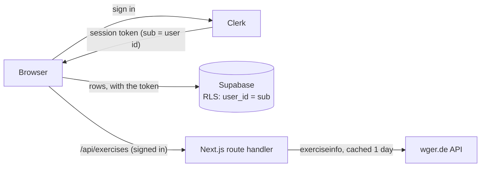
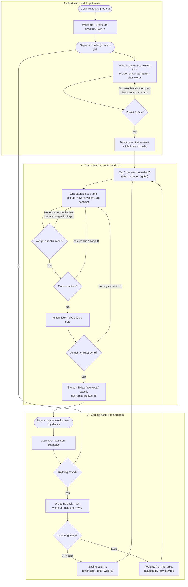

# Ironlog

**Never walk into the gym without a plan.** Tell Ironlog the kind of body you're
aiming for, in plain words. It builds your workouts and, every time you show up,
tells you exactly what to do: which exercises, how to do each one, and what weight
to start with. However long it's been since last time.

Built for MPCS 51238 *Design, Build, Ship*, Assignment 4: Full Stack App. Assignment 3
was a one-browser prototype; this version is a multi-user app:

- **Sign-in with Clerk.** Every page except the welcome and sign-in pages needs a session.
- **Data in Supabase.** Your look, workouts, remembered weights, check-ins and saved
  exercises live in four tables with row-level security, so each person reads and
  writes only their own rows, on any device.
- **An exercise library from the wger API.** Browse by muscle and equipment, read how
  to do each one, save the ones you like with your own note.

Next.js 16 (App Router) + Tailwind, deployed on Vercel. Free tiers only.

- **Live:** added with the Vercel deploy
- **Who it's for:** someone who goes to the gym *irregularly*, arrives with no plan,
  and doesn't want to learn muscle jargon or fill in a logbook. (This is the
  author: the app was rebuilt around that problem after the first release.)
- **What brings them back:** one useful next visit, however long it's been. The app
  remembers what you did and the weights you used, picks the next workout, eases you
  back in after a gap, and never shows a broken streak or "you missed 3 days".

## What's new in Assignment 4

| Piece | How it works |
|---|---|
| **Accounts** | Clerk (development keys). `proxy.ts` runs Clerk's middleware; each protected page calls `auth.protect()`, so a signed-out visitor is sent to `/sign-in` before anything renders. Signed out, `/` shows a welcome screen with *Create an account* and *Sign in*, and nobody's data. |
| **Database** | Supabase Postgres. Supabase trusts Clerk's session token (third-party auth), so the browser talks to Supabase directly with the signed-in person's token. Schema and policies are a migration: [`supabase/migrations/`](./supabase/migrations/). |
| **Isolation** | Row-level security on all four tables: select / insert / update / delete only where `user_id` is the token's subject. `user_id` defaults to that subject and is never sent by the app. The anonymous role has no access at all. |
| **Exercise library** | `/exercises` asks our own route handler (`/api/exercises`), which calls wger, trims the answer and caches it for a day. Saved exercises are rows in `saved_exercises`. |
| **Saving** | Changes show at once and are written in order through a small queue. If a write fails, a banner says *Your last change isn't saved yet* with *Try again*; nothing is dropped. If loading fails: *Couldn't load your training*, with *Try again*. Data is reloaded when you come back to the tab. |
| **Moving from Assignment 3** | Nothing is read from the old browser storage (it belonged to the browser, not a person). To bring old training across: *Plan → Download a backup* on the old site, then *Restore from a backup* here. |

### Data model

Clerk owns identity; `user_id` is the Clerk user id (`user_2abc…`, `text`).

| Table | One row per | Columns |
|---|---|---|
| `profiles` | person | `user_id` PK, `look_id`, `time`, `unit`, `weights` jsonb (weight memory per exercise), `nutrition` jsonb null, `created_at` |
| `workouts` | finished workout | `id` uuid PK, `user_id`, `date`, `key` (A/B/C), `unit`, `note`, `exercises` jsonb, `created_at` |
| `checkins` | monthly check-in | `id` uuid PK, `user_id`, `date`, `answers` jsonb, `created_at` |
| `saved_exercises` | exercise saved from wger | `id` uuid PK, `user_id`, `wger_id`, `name`, `muscles` text[], `equipment` text[], `image_url` null, `note`, `saved_at`; unique (`user_id`, `wger_id`) |

The database checks shapes too (A/B/C, kg/lb, note lengths, jsonb types, images only
from `https://wger.de/`), and the app re-validates every row it loads with the same
validators as before (`lib/data.ts`, `lib/rows.ts`, `lib/saved.ts`), so a bad row is
dropped with a notice instead of crashing a page.



### The wger API

- **Called from our server, not the browser.** wger returns every language: one
  muscle + equipment page is ~176 KB; trimmed to English and what the cards show it's
  ~13 KB. The route needs a session, so it isn't an open proxy, and refuses unknown
  muscle/equipment ids before calling wger.
- **Browse, then filter by name here.** wger's free-text search doesn't work, so the
  form asks for a muscle and/or equipment, and *Name contains* narrows the results as
  you type.
- **Descriptions are HTML written by the public.** The server strips them to plain
  text and the page never renders HTML.
- **Every state has a screen:** loading, nothing found, no names match (with *Clear
  the name*), wger down or slow (8 s timeout, with *Try again*), bad filter, signed
  out. Many exercises have no photo, so the card says *No photo on wger*.
- **Attribution:** wger's content is CC-BY-SA; every card shows *From wger.de ·
  license · by author*.

### Keeping keys out

Keys live in `.env.local` (git-ignored) and in Vercel's environment variables, never
in code. The coding agent is denied read access to `.env*` in `.claude/settings.json`,
so the author wrote that file. The app needs:

```bash
NEXT_PUBLIC_CLERK_PUBLISHABLE_KEY=
CLERK_SECRET_KEY=
NEXT_PUBLIC_SUPABASE_URL=
NEXT_PUBLIC_SUPABASE_PUBLISHABLE_KEY=
```

The Supabase key is the *publishable* one: with RLS it can only do what the signed-in
person's own token allows. No service-role key is used anywhere.

### Proving two people can't see each other's data

[`e2e/isolation.spec.ts`](./e2e/isolation.spec.ts) (Playwright, `npm run e2e`) signs
in two dedicated Clerk test users (`+clerk_test` addresses, development instance only):

1. **Signed out:** pages redirect to sign-in, `/api/exercises` returns 401, and the
   database refuses the publishable key on every table.
2. **A uses the app:** picks a look, saves a wger exercise with a note; the test waits
   until both are in Supabase.
3. **B's app shows none of it:** B is asked to pick a look; B's saved list is empty.
4. **B attacks the database directly** with B's own token: reading, filtering by A's
   id, updating, deleting, and inserting rows that claim to be A's. Reads come back
   empty, updates and deletes touch nothing, inserts are refused (403).
5. **A's data is untouched.**

Both test users' rows are wiped before and after each run.

## Carried over from Assignment 3: changes from TA feedback

- **"How are you feeling?" now visibly changes today's workout**, including the first
  one. *Tired*: no extras or finisher, one set fewer (never below two), the top of each
  rep range two lower, suggested weights ~10% lighter. *Fresh*: one extra set on the
  first two main lifts. A line under the picker says exactly what changed against
  *normal*, and changed numbers are highlighted with "normally 3 × 8–12".
- **Workout A, B and C in "Your plan" on Today are selectable** (a radio group).
  Picking one makes it today's workout; "Next up" still marks the rotation's
  suggestion, with a button back to it. The rotation carries on from the workout
  actually finished. On Plan they are a plain overview that says how they rotate.
- **Softer type and a light theme.** Sentence case everywhere, Big Shoulders only
  for headings and numbers, nothing under 14px. Light and dark themes follow the
  device by default; a *Theme* button in the header switches System / Light / Dark
  and remembers the choice. Contrast is computed for both themes (all WCAG AA).

## The flow

> I pick the body I want → I see my first workout right away → I do it, one exercise
> at a time, ticking off sets → I come back whenever, and it remembers me and tells
> me what's next.



The same diagram plus the screens, states and errors table is in
[`flows.md`](./flows.md).

## Pages

| Route | Step | What it does |
|---|---|---|
| `/` | First visit **and** coming back | No data: three-step explainer and the look picker. Has data: "Welcome back", the next workout and why, how long you have, how you feel, the exercise list with starting weights, a resume banner for an unfinished workout. |
| `/workout` | Main task | Guided gym mode, one exercise per screen: animated figure, how-to (open the first time you meet an exercise), weight box with −/+ steps, a button per set that starts the rest timer, "How did that feel?", swap if the machine is busy, skip. Then a finish screen to review, add a note and save. Saved as you go; keeps the screen awake. |
| `/progress` | Reason to return | Workouts, last 4 weeks, exercises learned; a calendar of gym days; each weight's trend and next suggestion; body check-in trends; full history with delete and undo. |
| `/checkin` | Optional | Monthly body check-in: weight and a few measurements, trend only, no targets. |
| `/plan` | Control | Change your look (the three workouts preview live), units, "What can training do?", food and sleep tips, an optional calorie and protein estimate, calendar reminders, backup/restore, reset (everything in your account, saved exercises included). |
| `/exercises` | Library | Find exercises on wger by muscle and equipment, narrow by name, read how to do each, save them. *Your saved exercises* below, each with a note you can add or edit, and remove with undo. |
| `/sign-in`, `/sign-up` | Account | Clerk's sign-in and sign-up. Signed out, `/` is a welcome screen; every other page sends you here. |

Shared navigation (a thumb-height tab bar on phones, header links on desktop) marks
the current page with `aria-current`. It hides during a workout, which has its own
Exit, so the screen is all lifting.

## How it decides what you do next

Plain rules, not AI, so the "why" on screen is always true (`lib/workouts.ts`,
`lib/adapt.ts`, tested):

1. **Your look sets the style.** Six looks (e.g. *Muscular & broad*, *Strong legs &
   glutes*, *Toned & defined*) map to a rep style and extra work for the right muscle
   groups. You never see the muscle groups; you pick a body.
2. **Three full-body workouts, A → B → C, repeating.** Not tied to weekdays: whenever
   you go, you do the next one. Because each trains your whole body, a missed week
   leaves no gap.
3. **It adapts to the visit:** a light intro the first time; *short / standard / long*;
   *tired* drops the extras, a set and a couple of reps and suggests lighter weights,
   *fresh* adds a set to two main lifts; skipped exercises come back next time; a workout
   less than half done is repeated.
4. **It eases you back in:** 2–4 weeks away = one fewer set and ~10% lighter; 4–8 weeks
   = two sets, ~20% lighter; 8+ weeks = two sets, ~30% lighter.
5. **It remembers weights:** *Easy* → up a step next time, *Hard* → down ~10%,
   *Just right* twice in a row → up a step.

## The honest part

The author asked whether to tell people the truth about what training can do. Yes.
Under the look picker and on the Plan page: *training builds strength and muscle;
how your body looks also depends on food, sleep and time; you can't choose where you
lose fat; "toned" usually means some muscle plus low body fat.* The app says it's
building **toward** a look, never promises one.

### Food, sleep and the body (what was added, and what wasn't)

The author asked for four extras. Three were built as asked; one was built in its
safe form:

| Asked for | Built |
|---|---|
| Food and sleep tips | A short card on Plan: protein at meals, 7+ hours of sleep, eat before training, give it time. Nothing to log. |
| "How are you feeling?" before each workout | One tap on Today: Fresh / Normal / Tired. Tired gives a shorter, lighter version. |
| Monthly body check-in | `/checkin`: optional weight and measurements, trend lines only, no targets or "ideal" numbers; a gentle prompt after 28 days. |
| Meal logging, calorie counts, weight targets | **An optional calorie and protein estimate** (Mifflin–St Jeor, adults 18+ only, shown as ranges, never below resting needs, with a "skip this if calorie counting has been stressful" line and "Delete my numbers"). **Not built:** meal-by-meal logging and weight goals. Logging needs a food database, which means an outside service the assignment rules out, and typing calories by hand is exactly the chore the app exists to remove. Weight targets were flagged as risky for body image in the research. |

## Onboarding research

Three subagents studied how **Fitbod**, **Strong**, and **Nike Training Club** welcome
new people (public sources only). Full notes: [`docs/research.md`](./docs/research.md).

| What we found | What we did |
|---|---|
| Fitbod: 14 onboarding steps and a paywall before the first workout. Nike: a full account first. Strong: sign-up, then an empty screen. | Assignment 3 had **no account**. Assignment 4 needs one (it's what lets your training follow you), so sign-up is Clerk's single screen, and after it there's still only **one question** (which body?) before a real workout. |
| Fitbod explains its picks; Strong's logger is clean. | A visible **"Why: …"** on every recommendation; a set is one tap, not a form. |
| Streaks and weekly targets everywhere. | **Cut**, for an irregular gym-goer they punish exactly the person the app is for. "Even one a week keeps what you've built" instead. |

## Design: "Iron"

A gym should look like a gym: concrete, caution-tape rules, heavy condensed
type (Big Shoulders) for headings and numbers, Barlow for everything else, sentence
case throughout. Light and dark themes (tokens in `app/globals.css`).

- **Safety yellow is reserved for the one primary action on a screen** and the focus
  ring (a dark ochre ring in light mode, where yellow on white is too faint).
  Selected choices are an ink fill, never yellow.
- **Shared components** (`components/`): `Button`, `Field` (label + hint + error +
  control), `Input`/`Textarea`, `Segmented`, `LookPicker`, `Silhouette`, `Banner`,
  `Dialog`/`ConfirmDialog` (native `<dialog>`), `RestTimer`, `ExerciseFigure`,
  `Calendar`, `Sparkline`, the nav.
- **Exercise figures** are small animated SVGs posed from a jointed stick figure
  (`lib/poses.ts`), one per exercise, paused when off-screen and still for
  reduced-motion users.

### Forms and errors

One column of fields with a real `<label>` each. Errors sit under the field and say
what to do: *"Enter the weight as a number in lb, like 45 or 22.5 — or leave it
blank."* On any error the form **keeps everything typed**, marks the field
`aria-invalid`, ties the message with `aria-describedby`, and moves focus to the
problem (or to an error summary listing them).

### Remembering you

Everything you'd miss lives in your account (the four tables above). Only two things
stay in the browser: the theme choice (`ironlog:theme`), and a workout in progress
(`ironlog:workout:v2:<your user id>`, so it's saved on every tap, survives a reload
and expires after 24 h). That key includes your Clerk id, only your own is read, and
everyone else's is cleared when the account in the browser changes or you sign out.
Loading validates every field, so corrupt data can't crash the app; unreadable parts
are dropped and a notice says so. Weights keep the unit they were typed in and convert
only for display.

## Accessibility

- **Keyboard:** every flow works without a mouse (scripted: onboarding with only Tab,
  arrows, Space and Enter). Choices are real radio inputs; set buttons are toggle
  buttons with `aria-pressed` and names like "Set 2 of 3"; moving to the next exercise
  moves focus to its heading; dialogs trap focus and return it.
- **Contrast** was computed (WCAG ratios, on the actual background):

  | Pair | Ratio | Needs |
  |---|---|---|
  | Text on background / surface / raised | 17.8 / 16.4 / 14.6 : 1 | 4.5 |
  | Muted text on background / surface / raised | 8.1 / 7.5 / 6.7 : 1 | 4.5 |
  | Ink on the yellow button | 13.8 : 1 | 4.5 |
  | Yellow focus ring on background / surface | 13.8 / 12.7 : 1 | 3 |
  | Error text on surface | 7.8 : 1 | 4.5 |
  | Input border on surface | 5.2 : 1 | 3 |

- **Automated audit:** axe-core (WCAG 2.0/2.1 A + AA + best practices) across 13 states
  at 390px and 1440px (26 runs): first visit, its error, returning, exercise card,
  weight error, set done with rest timer, swap dialog, finish, progress, a workout
  opened, check-in errors, plan, estimate errors. **No violations.** (It caught one
  real issue first: the rest timer's "+30s" button had a spoken name that didn't
  contain its visible text, which breaks voice control. Fixed.)

## Tech and decisions

TypeScript, Next.js 16 (App Router) + Tailwind, `@clerk/nextjs`, `@supabase/supabase-js`.
Who decided what (the author's directions versus the agent's proposals) is recorded in
[`docs/decisions.md`](./docs/decisions.md).

```bash
npm install
# put the four keys above in .env.local
npm run dev      # http://localhost:3000
npm run build
npm run lint
npm test         # 194 tests: plans, re-entry, weight memory, validation, rows to and from the database, saved exercises, wger trimming, backup, check-ins, estimate, how-to text, figures
npm run e2e      # Playwright: two users can't see each other's data (needs the dev server's keys)
```

Schema changes are migrations in `supabase/migrations/`, never edits in the dashboard.

Browser checks from Assignment 3 (Playwright, not part of the build) live in
[`scripts/verify/`](./scripts/verify/README.md): `v3-check.js` walks every journey and
`a11y-check.js` runs the axe audit. They were written for the signed-out, one-browser
version and haven't been updated for sign-in.

## First-run check (Assignment 3)

After deploying Assignment 3, an agent played a brand-new, irregular gym-goer on the live site
(phone, plus a desktop look), told not to read the code, with the goal *"tell it the
body I want, do my first workout, save it, come back weeks later."* Full report:
[`docs/first-run-check.md`](./docs/first-run-check.md) (the first release's check, and
what changed then, is below it).

**What worked:** understood in 5 seconds; 3 taps to a real workout; keyboard-only
onboarding; each exercise "very clear for a beginner"; every error next to the problem
with typed text kept; after a faked 5-week gap: *"Welcome back after 5 weeks — easing
in with two sets and lighter weights"*, the next workout with its reason, and the
skipped exercise brought back.

**What it found, and what changed:**

| Finding | Change |
|---|---|
| Bug: the "pick a look" error was off-screen on a phone | Error above the cards, page scrolls to it; now asserted by the journey check |
| Bug: plank target (30–45 s) contradicted its tip (10–20 s) | 20–30 s holds; the tip matches |
| Visit 2 jumped to 9 exercises (~70 min) | One make-up exercise on a standard day |
| "Nice work" with nothing done; half-done exercises counted as done | "Finish workout"; "2 finished, 2 partly done" |
| "20kg" rejected without a reason | Says to type just the number and where to switch units |
| How-to pushed the controls two screens down | Weight and sets first, how-to underneath |
| "Lighter weights" after a gap, but one stayed the same | Always at least one step lighter |
| +/− moved a single dumbbell 10 lb | 5 lb steps for single-dumbbell moves |
| The six figures looked alike | Redrawn with clearer proportions |

This is an agent's feedback, not human testing: no real phone, screen reader or real
time away.

## Context file

`AGENTS.md` is the project's context file (constraints, product rules, design, layout,
gotchas). Claude Code only loads `CLAUDE.md` on its own, so the first `/context` check
showed no memory files at all. The fix: `CLAUDE.md` is a single line, `@AGENTS.md`, which
imports it. Everything lives in AGENTS.md; nothing else is in CLAUDE.md. `/context` then
lists AGENTS.md as loaded:


## Known limitations

- Clerk runs on **development keys** (the assignment's scope): fine for a class demo,
  with Clerk's development banner and limits.
- The wger library shows at most 100 exercises per search and only what wger has in
  English; photos are often missing. If wger is down, the library says so; your saved
  exercises still show.
- Changes are saved straight away but need a connection. Offline, the change shows
  and the banner says it isn't saved yet until *Try again* works.
- Plans are general guidance for healthy adults, not medical advice or a personal
  trainer. The calorie estimate is a population formula that can be off by 10–20%.
- Checks here are agent-driven (unit tests, the isolation test, an agent playing a new
  user in Assignment 3), not a substitute for watching real people use it.
