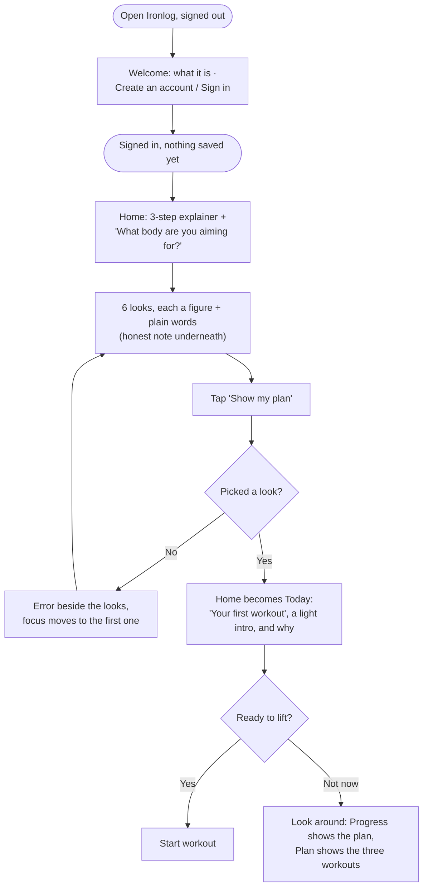
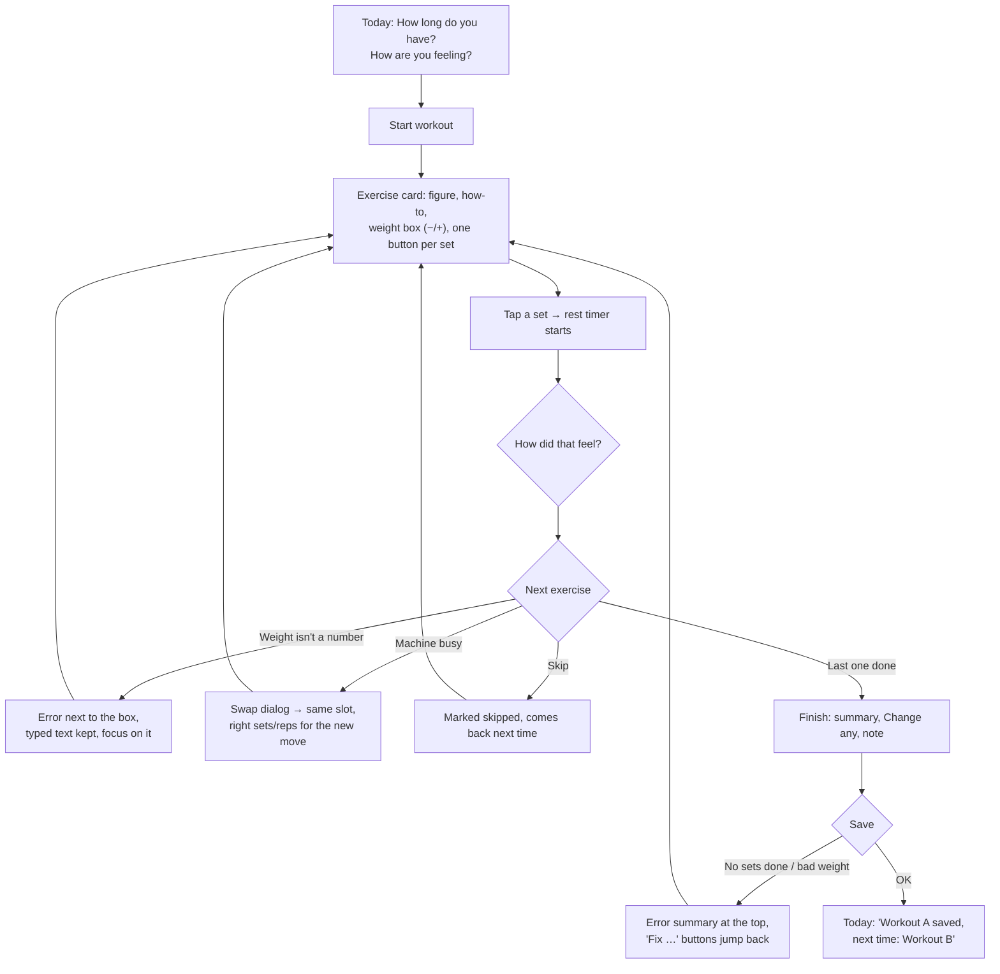
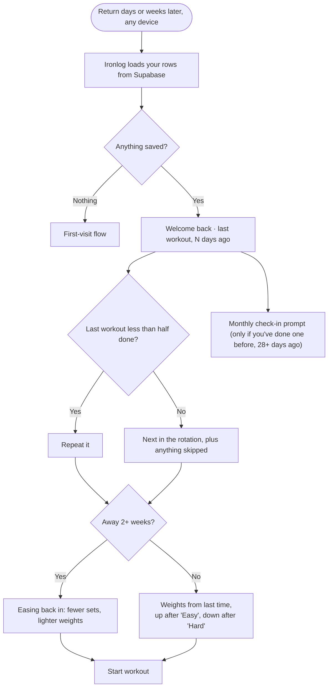

# Flows

**The main task, as a sentence:**
I pick the body I want → I see my first workout right away → I do it, one exercise
at a time, ticking off sets → I come back whenever, and the app remembers me and
tells me what's next.

## The three flows

### 1. First visit, useful right away

One sign-up screen (Clerk), then no tour and no empty screen: one question from a new account to a real workout.

### 2. The main task: do the workout

Every tap is saved as you go, so a locked phone, a reload or a stray tap never loses
your place; Today offers "Resume workout".

### 3. Coming back, it remembers

## Screens and states (what the agent proposed, and what was kept)

The agent proposed these screens, states and errors from the flow sentence; the author
chose what to keep. Kept from the agent: resume a workout in progress, swap when a
machine is busy, repeat a mostly-unfinished workout, easing back in after a gap, undo
after delete. Cut by the author: muscle and equipment questions, streaks, a
set-by-set logbook. The full record of who decided what is in
[`docs/decisions.md`](./docs/decisions.md).

| Screen | Route | States | Errors |
|---|---|---|---|
| Welcome | `/` signed out | what Ironlog is, Create an account / Sign in | — |
| Today | `/` | loading, first visit (look picker), first workout, returning, back after a gap, tired, workout in progress | no look picked; couldn't load → banner with Try again; a change not saved → banner with Try again; unreadable rows → keep what's readable, say so |
| Workout | `/workout` | no workout in progress, exercise card (new / done before), set done + rest, skipped, swap dialog, finish, exit confirm, discard confirm | weight not a number / over 1000; no sets done |
| Progress | `/progress` | plan-only (never blank), has workouts, has check-ins, deleted (undo) | — |
| Check-in | `/checkin` | empty, saved, history, deleted (undo) | no measurement; not a number; implausible value; future date |
| Plan | `/plan` | look + live preview, units, estimate (form / result), reminders, backup, reset confirm | estimate: age (adults only), formula version, height, weight, activity |
| Exercises | `/exercises` | find form, loading, results, nothing found, no names match, saved list (empty / items), note form, removed (undo) | no muscle or equipment picked; wger down (Try again); bad filter; signed out; note too long |

Considered and **cut**: muscle or equipment questions, streaks and weekly targets,
meal logging, weight goals, daily sleep logs. (Accounts and sync were cut in Assignment 3
and added in Assignment 4.)
